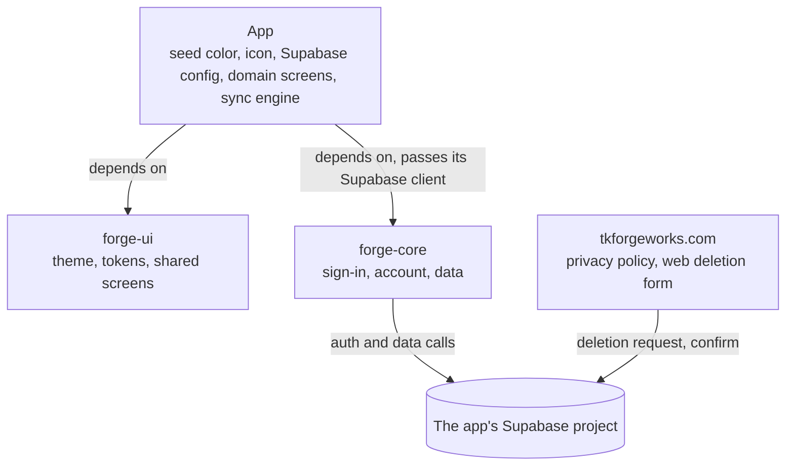

# forge-ui & forge-core: Shared Flutter Packages Spec

Oct 8, 2026 · @Tim Klimpel · Status: Approved · Revised Oct 17, 2026 (0.3.0 account and sync decisions, FC-1; earlier revision Oct 10, 2026)

This file in `tkforgeworks/forge-core` is the canonical copy. `forge-ui/docs/` holds a pointer to it, not a copy.

## Purpose and goals

All tkforgeworks client apps move to Flutter, so two shared packages carry the parts every app repeats: `forge-ui` for the brand look and the screens every app has, `forge-core` for sign-in, account and data plumbing. Each app supplies only its colors, icon, Supabase config and domain screens.

Goals:

- **One brand, many apps.** Typography, shapes, spacing and shared screens are identical across apps; each app changes its seed color and icon.
- **Write auth and account deletion once.** Google and email/password sign-in, email confirmation, password reset, identity linking and account deletion live in `forge-core`, not in each app.
- **Store-ready by default.** Any app built on the packages starts compliant with Google Play's account-deletion requirement (in-app deletion plus a web deletion URL) and a short, honest privacy disclosure. Apple guideline 4.8 (Sign in with Apple) applies once an iOS app exists.
- **Local-first apps stay local-first.** Signing in is optional and only turns on backup and sync; the app works fully with no account.

Non-goals for v1: analytics, crash reporting, push notifications, file/photo storage helpers, a shared sync engine (sync is app-side, see Data model), and a lint/CLAUDE.md org standard.

## Scope and package boundaries

Apps depend on both packages; the two packages never depend on each other. Shared screens in `forge-ui` (sign-in, account settings) take callbacks, and each app wires those callbacks to `forge-core`. This keeps `forge-ui` free of Supabase and `forge-core` free of styling.

| Layer | Owns | Examples | Never contains |
| --- | --- | --- | --- |
| `forge-ui` | Brand look and the screens every app has | Theme builder, tokens, buttons, cards, form fields, empty/error/loading states, dialogs, settings, about and licences scaffolds, sign-in and account screens | Supabase calls, app-specific widgets, hardcoded colors (two named exceptions below) |
| `forge-core` | Account and data plumbing | Sign-in (Google, email/password), email confirmation and password reset, identity linking, account deletion, session state, jsonb repository helper | Supabase URL/keys, app schemas, UI styling |
| Each app | Its identity and domain | Seed color, icon, Supabase config, tables, sync engine, domain screens (e.g. cheese tasting forms) | Copies of shared widgets or auth code |

**Shared first for high-reuse screens.** Screens every app is certain to have (sign-in, account, settings, about, licences, feedback) are built in `forge-ui` from the start, even when only one app consumes them yet, so the next app gets the same views without a migration. Release candidates and pin moves are cheap. The **rule of three** (promote only when a second app needs it, ideally confirmed by a third) applies to everything whose reuse is ambiguous: domain-flavoured widgets, sync engines, data helpers beyond the generic shape. (Revised 2026-10-17; the earlier text applied the rule of three to every screen.)



There is no arrow between the two packages. Only `forge-core` talks to Supabase from the app, and only the app knows which Supabase project it talks to. The website talks to the same project through two Edge Functions `forge-core` ships (see Account deletion).

## forge-ui design

`forge-ui` exports one theme builder: an app passes its seed color (and optional accent), and everything else about the brand is fixed inside the package.

```dart
ThemeData forgeTheme({
  required Color seed,
  Color? accent,
  Brightness brightness = Brightness.light,
  ColorScheme? colorScheme,
  ForgeTokens? tokens,
  Iterable<ThemeExtension> extensions = const [],
}) {
  final scheme = colorScheme ?? forgeColorScheme(seed: seed, brightness: brightness);
  final forge = tokens ?? ForgeTokens.standard(scheme, accent: accent);
  return ThemeData(
    colorScheme: scheme,
    textTheme: ForgeType.textTheme(scheme, forge),
    // ...every component theme: buttons, cards, inputs, chips, sheets, drawer
    extensions: [forge, ...extensions],
  );
}
```

- **A seed is enough.** `forgeColorScheme` is Material's seeded scheme with quieter outline colors, because the brand draws its borders and dividers as soft lines.
- **An app with a designed palette passes its own `colorScheme` and `tokens`**, one pair per brightness. The brand's type, shapes and component themes apply on top unchanged. The cheese app does this to keep its cream and rind-amber palette.
- **`ForgeTokens`** holds the color roles `ColorScheme` has no slot for (tertiary and ghost text, link, row divider, success pair, error tint, skeleton shimmer, accent). An app's own roles go in its own extension, passed through `extensions`.

| Fixed in forge-ui (the brand) | Set per app |
| --- | --- |
| Typography and type scale | Seed color, optional accent; or a designed color scheme and tokens |
| Corner radii, spacing scale, elevation | App icon and name |
| Button, card, input and dialog shapes |  |
| Motion durations and curves |  |
| Icon style (Heroicons, outline) |  |
| "Made by tkforgeworks" about screen, licences screen |  |
| Sign-in and account screens |  |

**Hard rule: shared widgets never hardcode a color.** Every color comes from `Theme.of(context).colorScheme` or the `ForgeTokens` theme extension. One hardcoded color breaks theme swapping for every app. Two named exceptions, both tested for:

- **`ForgeBrand`**: the forge gradient and the colors of the hammer-and-anvil mark, identical in every app.
- **`ForgeProviderBrand`** (v0.2): the fill, stroke and text colors Google (and later Apple) mandate for their sign-in buttons. Google's current rules: light `#FFFFFF` fill with a 1 px `#747775` stroke and `#1F1F1F` text; dark `#131314` / `#8E918F` / `#E3E3E3`; neutral `#F2F2F2`, no stroke, `#1F1F1F` text; the "G" logo always in its standard colors. These are the provider's rules, not the brand's, so the constants live apart from `ForgeBrand`.

A test in the package fails on any other color literal.

**Fonts are fixed and bundled in forge-ui.** Apps don't override them. The three brand families are the ones the cheese app and the website already use; a fourth exists only for provider buttons:

| Family | Role | Weights bundled |
| --- | --- | --- |
| Poppins | UI: titles, body, buttons, form fields | 400, 500, 600, 700 |
| Source Serif 4 | Editorial: long-form text, names, taglines | 400 and 600, each with italic |
| JetBrains Mono | Labels, tags and codes | 400, 500 |
| Google Sans Flex (v0.2) | The label of the Google sign-in button only; Google's branding guidelines require Google Sans Medium | 500 (one static instance cut from the variable font) |

- The .ttf/.otf files live in `forge-ui/assets/fonts/` and are declared under `fonts:` in forge-ui's `pubspec.yaml`. Apps get them through the dependency, with no copying. (The families resolve as `packages/forge_ui/Poppins` and so on.)
- Static instances, not variable fonts, so `FontWeight` selects the face directly. A new weight is added to the package before any widget uses it.
- No runtime font download through `google_fonts`. A download is an undisclosed network call to Google and fails offline.
- Only SIL Open Font License (OFL) fonts. Each family's OFL text ships beside the files, is listed in `NOTICE`, and is registered with `LicenseRegistry` (`registerForgeFontLicenses()`) so it shows on each app's licenses page.
- Google Sans Flex is Google's OFL 1.1 rebuild of the proprietary Google Sans (released on Google Fonts in November 2025). The proprietary Google Sans must not be bundled. When instancing the variable file, honour the OFL's Reserved Font Name rule (rename the instance if the licence reserves the name). If the licence check fails, fall back to Roboto Medium (Apache-2.0) and record the deviation from Google's guideline in the package README.
- No commercial fonts unless their license explicitly covers app embedding. Modified OFL fonts get a new name.

**Icons are Heroicons, outline style.** `forge_ui` depends on the `heroicons` package (MIT) and its shared widgets use the outline style. Apps use the same package and style on their own screens. Provider logos (the Google "G") are the providers' official assets, bundled under `assets/brand/providers/`, all rights reserved by their owners and listed in `NOTICE`.

Widget set, by release:

| Release | Ships | Alongside | Status |
| --- | --- | --- | --- |
| forge-ui v0.1 | Theme builder, tokens and component themes (buttons, cards, inputs, chips, segmented toggle, switch, slider, drawer, sheets); mono label, tag and status capsules, boxed field, confirm sheet (including the destructive delete confirmation), empty, error and loading states, settings group, the gradient FAB, the TK ForgeWorks mark; about screen with privacy-policy, feedback and deletion links (`onSendFeedback`, `onOpenDeleteAccount`), and the licences summary screen | — | Released 2026-10-14 (`v0.1.0`); cheesy-scribe 0.2.0 ships on it |
| forge-ui v0.2 | `ForgeSignInProvider`, `ForgeSignInButton` (Google per `ForgeProviderBrand`; Apple reserved), `ForgeSignInPanel` (Google button + email/password form: sign in, create account, forgot password) and `ForgeSignInScreen` (panel + optional skip); "check your email" and "set a new password" screens; `ForgeAccountSettings` (signed-out and signed-in states); `ForgeSignOutSheet` with the "also erase this phone" option; `showForgeConfirmSheet(typeToConfirm:)`; busy states on buttons and sheets | forge-core v0.1 | Planned; consumed by cheesy-scribe 0.3.0 |
| later | Apple sign-in button and linked-method row; a shared settings "Backup" group once a second app syncs | forge-core with Apple | Deferred with iOS |

The v0.1 contents were the generic pieces of the cheese app, promoted as they stood. Its journal field, star rating, flavor wheel and other domain widgets stay in the app.

The screens that front `forge-core` ship with the `forge-core` release they pair with, so their callbacks are shaped against the real API rather than a guess. The two packages' release candidates are developed together against the cheese app's `v0.3.0/main`.

**Sign-in panel and screen.** Callbacks in, no auth logic. `onGoogle` and `onApple` are nullable; a null callback means that button is not rendered, which is how an Android app leaves out Apple. The email/password form is always present (`onEmailSignIn(email, password)`, `onEmailCreate(email, password)`, `onForgotPassword(email)`), since every app offers it. A debug assert requires at least one provider button. On iOS an app passes both Google and Apple (Apple guideline 4.8). The screen variant takes `onSkip` for apps where sign-in is optional, and the panel can be embedded in an app's own Account screen (cheese does this: the signed-out Account page shows the panel under the local profile).

**Account settings.** `forge-ui` cannot import `forge-core`, so it defines its own plain types for linked sign-in methods, and the app maps `forge-core`'s identities onto them. `forge-ui` owns each provider's label and logo, so every app shows them the same way.

```dart
enum ForgeSignInProvider { google, email, apple }

@immutable
class ForgeLinkedSignIn {
  const ForgeLinkedSignIn({required this.provider, this.email});
  final ForgeSignInProvider provider;
  final String? email; // may be an Apple relay address, later
}

ForgeAccountSettings(
  email: email,                      // the account's primary email
  username: username,                // null until the user sets one
  onUsernameChanged: (value) {...},
  linked: [ForgeLinkedSignIn(provider: ForgeSignInProvider.google, email: email)],
  onLink: (provider) {...},          // null hides "Link another sign-in method"
  onSetPassword: () {...},           // for Google-only accounts adding email/password
  status: backupStatusWidget,        // the app's sync status row; forge-ui draws the slot
  onSignOut: ({required bool eraseLocal}) {...},
  onDeleteAccount: () {...},         // the app calls forge-core after the typed confirmation
)
```

Material 3 is the base. If iOS later needs a more native feel, the platform adjustments go inside `forge-ui`, not in each app.

## forge-core design

`forge-core` wraps Supabase Auth (`supabase_flutter` 2.x; the 3.0 prereleases are not adopted until stable) and a small jsonb data layer. Every app offers the same sign-in methods on every platform, and one Google identity or email address always reaches the same account.

### Sign-in flows

| Platform | Google | Email / password | Apple |
| --- | --- | --- | --- |
| Android (now) | Native `google_sign_in` 7.x (Credential Manager) `authenticate()` → `signInWithIdToken` | `signUp` / `signInWithPassword`; confirmation and reset by email with a deep link back into the app | Not offered (Play has no requirement; see Deferred) |
| iOS (later) | Native `google_sign_in` → `signInWithIdToken` | same | Native `sign_in_with_apple` → `signInWithIdToken` (guideline 4.8) |
| Web (future) | `signInWithOAuth(OAuthProvider.google)` | same | `signInWithOAuth(OAuthProvider.apple)` |

**Google on Android**, once per app, in Google Cloud:

- A **Web** OAuth client first; its client ID is the Supabase Google provider's client ID and the app's `serverClientId`. The app receives an ID token audience-matched to it.
- **Android** OAuth clients for every signing certificate that will run the app: the **Play app-signing** key, the **upload** key, and the **debug** key of each development machine. A build signed with a key that has no client cannot sign in; CI's keystore-less `-debugsigned` builds use a throwaway key and never sign in.
- Consent screen in production (basic scopes need no verification review); the app's Play listing name and privacy URL on it.
- `google_sign_in` 7 is initialize-once, so there is no per-attempt nonce. Pass none (or one per process) on Android; when iOS arrives, enable Supabase's "Skip nonce check" for the Apple provider only if its native flow needs it. Spike whether omitting the access-token request avoids a second consent prompt.

**Email and password:**

- Confirmation is required before a session is usable (Supabase default); the confirmation and password-reset emails carry a link whose redirect is the app's own URL (an HTTPS Android App Link on the org site, preferred since cheesy-scribe 0.3.0, or the custom scheme `<applicationId>://auth-callback`), registered as an additional redirect URL on the project, so `supabase_flutter` completes the flow in-app. Links expire; the screens offer "send again".
- Auth email goes through **Resend as the project's custom SMTP** from a tkforgeworks.com sender. The built-in mailer is capped at a few messages an hour per recipient and sends from a shared domain. Templates are branded once per project from `forge-core`'s copies.
- Password rules: Supabase's minimum length (8) with the leaked-password check on.

**Identity linking.** Supabase links a new Google sign-in to an existing account with the same verified email automatically. Beyond that, `forge-core` exposes:

- `linkGoogle()` → `linkIdentityWithIdToken` (native, no browser), for an email account adding Google;
- `setPassword(password)` → `updateUser`, for a Google-only account adding email/password (its email is already the account's email);
- the "identity is already linked to another user" error surfaced as a typed result, so the UI can explain it.

Manual linking is a per-project Auth setting that must be on for `linkGoogle()`.

**Session state.** `forge-core` exposes the current user and auth state as a stream the app's providers wrap, plus `signOut()`. It never reads or writes app storage; what happens to local data on sign-out is the app's decision (cheese keeps it, see Account deletion).

**Username.** Not prefilled from the provider. When the user enters one, the app calls `setUsername()` and it is stored in `accounts.username`. Apps keep their local display name separately (cheese keeps `AppSettings.displayName` on the device and copies it up when the user has an account).

### Apple sign-in (deferred until an iOS app exists)

No tkforgeworks app targets iOS, so Apple sign-in, the App ID and Services ID, the .p8 signing key, the Vault-stored refresh token, revocation during purge, Hide My Email handling and the client-secret rotation job all wait for the first iOS app. Play has no Sign in with Apple requirement; Apple guideline 4.8 is App Store only. The Oct 10 revision of this spec describes that design and remains the plan when it is needed: native `sign_in_with_apple` → `signInWithIdToken`; the purge revokes the Apple token through the .p8 before deleting the user; Apple's user identifier is stable per developer team across native and web flows.

### Account deletion

Google Play requires in-app account deletion and a web deletion URL from the moment users can create accounts, including closed testers. So `forge-core` v0.1 ships sign-in **and** deletion together, and no app ships a tester build with sign-in before deletion works in that same build.

One `deleteAccount()` call does all of it:

1. Call the `request_account_deletion()` database function, which sets `accounts.deletion_requested_at` for the caller, then sign out every session. From that moment row-level security refuses the account's rows (see the data model), even for an access token that has not expired yet.
2. A purge Edge Function (authorised with the project's `sb_secret_…` key) deletes the user's Storage objects through the Storage API (recursively under the user's prefix; SQL deletes on Storage have been blocked since March 2026), deletes any Vault secrets for the user, then deletes the Supabase auth user.
3. The `accounts` row and all `entries` rows go with it through `on delete cascade`.
4. **The device copy is the app's decision.** In cheese, deletion and sign-out keep the notes on the phone by default and offer "also erase this phone" (revised 2026-10-17; the earlier text wiped local storage). The confirmation is the typed kind: the user types DELETE.

**What drives the purge.** Setting the flag starts a first purge attempt straight away. A scheduled job in the database (`pg_cron` calling the function through `pg_net`, every 15 minutes) re-runs the purge for every account whose `deletion_requested_at` is still set, so a failed attempt is retried until it succeeds. The key `pg_net` sends lives in Vault. Both are set up by `forge-core`'s migration; confirm `pg_cron`, `pg_net` and Vault are enabled on the project.

No anonymized copies are kept. Entries are private and their free text can itself hold personal details, so deletion removes them. If usage stats are ever wanted, keep an aggregate counter with no content and no user link. The privacy policy states the purge window.

**Web deletion requests.** Each app has its own page at `tkforgeworks.com/privacy/<app>/delete-account/` (the Google Play deletion URL and the Data safety "deletion request" URL), linked from that app's privacy policy at `/privacy/<app>/`. The page names the app as it appears on the store listing, lists what gets deleted and the purge window, and hosts a request form that feeds the same purge pipeline:

1. The form takes the account email, protected by Cloudflare Turnstile and a WAF rate limit, and posts to a **Pages Function on the website** (the same pattern as the feedback relay in `functions/api/`).
2. The Pages Function calls `forge-core`'s **request** Edge Function on that app's Supabase project. The function emails a single-use confirmation link (Resend) if that email matches an account. The response is identical either way, so the form can't be used to discover accounts. The token is stored only as a hash, with an expiry, in a table in a private schema that the API does not expose.
3. Clicking the link calls the **confirm** Edge Function, which sets `accounts.deletion_requested_at`, and the standard purge runs from there.

The website holds no Supabase secret: the request function is public and rate-limited, and authorises its own privileged work in code with the `sb_secret_…` key (`verify_jwt = false`). Policy stays in `forge-core`; the website only renders the page and forwards the request.

The purge, request and confirm Edge Functions and the `accounts` migration live in `forge-core` under `supabase/`. `bin/sync_supabase.dart` copies them into an app's `supabase/` folder at the app's pinned tag, and the app deploys them with the Supabase CLI (manual runbook first; an org `deploy-supabase.yml` later). A drift check the app runs from one test inside `flutter test` fails if the copies differ from the pinned version, so no app can quietly change the deletion policy.

### Data model

One generic table shape per app, scoped by row-level security, with the two columns an app-side sync needs:

```sql
create table entries (
  id uuid primary key,                       -- client-supplied (apps already use UUID v4)
  user_id uuid not null references auth.users on delete cascade,
  kind text not null,
  data jsonb not null,
  created_at timestamptz not null default now(),
  updated_at timestamptz not null,           -- client-supplied; last write wins
  deleted_at timestamptz                     -- tombstone; data is '{}' once set
);
create index entries_user_updated on entries (user_id, updated_at);
alter table entries enable row level security;
create policy "own rows" on entries
  for all using (auth.uid() = user_id and forge_account_active())
  with check (auth.uid() = user_id and forge_account_active());
```

Every app also gets an `accounts` table, one row per user. The migration creates it before `entries`, because the policy above calls `forge_account_active()`:

```sql
create table accounts (
  id uuid primary key references auth.users on delete cascade,
  username text,
  created_at timestamptz not null default now(),
  deletion_requested_at timestamptz
);
alter table accounts enable row level security;
create policy "own row" on accounts for select using (auth.uid() = id);

-- True while the caller's account is not pending deletion.
create function forge_account_active() returns boolean
  language sql stable security definer set search_path = ''
  as $$
    select exists (
      select 1 from public.accounts
      where id = auth.uid() and deletion_requested_at is null
    );
  $$;
```

- **Rows are created by a trigger** on `auth.users`, so an account never exists without its row.
- **The client reads only its own row and never writes the table directly.** There is no insert, update or delete policy. Changes go through security-definer functions that act on `auth.uid()` only: `request_account_deletion()` sets the flag and `set_username(text)` sets the username.
- `deletion_requested_at` marks an account as pending deletion so a failed purge can be retried; it never keeps a deleted account around.

Server-side state that is not user data stays out of reach of the client: the web-deletion confirmation tokens sit in the private schema described above, and (later) Apple refresh tokens in Vault.

**Cascade rule.** Every table holding user-owned rows declares `user_id uuid not null references auth.users on delete cascade` and includes `forge_account_active()` in its policy, as `entries` does. Postgres's default (no action) would block the purge instead of deleting the rows. Vault secrets and files in Supabase Storage are not rows that cascade, so the purge function deletes them explicitly before removing the auth user.

**Storage path rule.** A user's files live under `<bucket>/<user_id>/...`. The purge walks every bucket in the project and deletes that prefix, so it needs no per-app configuration and a new bucket cannot be forgotten.

**Repository helper.** `forge-core` ships a typed repository over this shape (`kind` + a `fromJson`/`toJson` pair per type) with the calls a sync engine needs: `upsertAll(rows)` keeping client-supplied `id` and `updated_at`, a paginated `listKeys()` returning `(id, updated_at, deleted_at)` for the user (optionally since a timestamp), `fetchByIds(ids)`, and `markDeleted(ids)`.

**Sync is app-side.** The recommended model, which cheese 0.3.0 implements, is last-write-wins per entry with tombstones as a manifest diff: push local dirty rows, list the server's keys, fetch rows newer than the local copy, apply, then clear dirty flags. An app needs its own bookkeeping first (cheese: schema v3 with `updated_at`, `dirty`, a tombstones table and a `sync_meta` table; its settings table can't hold sync state because its settings save rewrites every row). Sync runs on start, resume and after a save, waits when offline or when the project is unreachable, and never blocks the UI. The engine is promoted into `forge-core` only when a second app syncs (rule of three: reuse is ambiguous until then).

- Fields move from `data` into real columns only when an app needs to query or index them.
- Each app owns its Supabase project, migrations and table names; `forge-core` takes the client as a parameter.

### App configuration

The Supabase URL, the `sb_publishable_…` key and the Google web client ID are public by design but are **not committed**: they reach the app as `--dart-define` values read by `ForgeSupabaseConfig.fromEnvironment()`. Locally, a gitignored `--dart-define-from-file` JSON per developer; in CI and release, the org `release-flutter.yml` gains an input that turns repository secrets into defines. The `sb_secret_…` key never leaves the Supabase project (Vault, Edge Function secrets); legacy `anon`/`service_role` keys are retired by the end of 2026 and are not used.

## Privacy and store compliance

Apps built on the packages collect only what sign-in and the app's own data need, so every app starts from the same inventory and adds rows only for what it adds.

| Data | Purpose | Google Play Data safety | Apple privacy label (when iOS ships) |
| --- | --- | --- | --- |
| Email | Account, sign-in mail | Personal info → Email address | Contact Info → Email Address |
| Username (optional) | Display | Personal info → Name | Contact Info → Name |
| Account ID | Authentication | Personal info → User IDs | Identifiers → User ID |
| User entries | App functionality (backup and sync) | App activity → Other user-generated content | User Content → Other User Content |
| Feedback form contents (optional; only apps with the in-app form) | Support; sent on Send only via the website relay (Cloudflare, Resend as processors) | Personal info → Other info; email if given | — |

Declared for every row: linked to the user, not used for tracking, encrypted in transit, deletable on request.

Requirements every app meets before an account-enabled build reaches any tester:

- [ ] Google and email/password sign-in on Android; Google **and** Apple on iOS when an iOS app exists (Apple guideline 4.8)
- [ ] In-app account deletion via `forge-core`, in the same build as sign-in
- [ ] Deletion page and request form at `tkforgeworks.com/privacy/<app>/delete-account/`, entered as the Play deletion URL and in Data safety
- [ ] Privacy policy at `tkforgeworks.com/privacy/<app>/`, naming Supabase as the data processor and its hosting region, Resend for email, and the purge window
- [ ] Data inventory kept in the app repo (`PRIVACY.md`) and updated before any new SDK or field ships
- [ ] Play Data safety form updated and re-reviewed; App access section given a reviewer account (a Google account without 2FA, or an email/password test account)
- [ ] No analytics or crash-reporting SDKs unless added to the inventory first
- [ ] Server functions never log the contents of `data`

`forge-core` ships a privacy policy template and the base inventory so each app only fills in its own rows.

## Repos, versioning and distribution

Each package lives in its own repo (`tkforgeworks/forge-ui`, `tkforgeworks/forge-core`) and apps consume it as a git dependency pinned to an exact release tag.

```yaml
dependencies:
  forge_ui:
    git:
      url: https://github.com/tkforgeworks/forge-ui.git
      ref: v0.1.0
```

- **Semantic version tags, pinned exactly.** An app names one tag, so changing that line is the only way it picks up brand changes. Version-range constraints on the git dependency were considered and turned down.
- **Release candidates.** `vX.Y.Z-rc.N` tags are cut from the release branch so an app can adopt and test a version before its stable tag exists.
- **Releases come from the org Flutter release pipeline** with both platform builds off. A package release is a tag and a GitHub release whose notes are the commit subjects; there are no files to attach. forge-ui adopted it (its PR #6); forge-core adopts it in its first v0.1.0 topic PR.
- **Additive changes.** New parameters get defaults, so an app can move to a newer tag without touching its screens. Breaking changes bump the major version and come with a migration note.
- **Toolchain.** Both packages and every app pin Flutter 3.47.5 in CI (forge-ui's goldens are rendered on it), with a lower `environment` floor (`sdk: ^3.13.2`, `flutter: ">=3.47.2"`) so a pin move is one change in each repo.
- **Jira.** forge-core is project **FC**, forge-ui is **FU** (both created 2026-10-17). Commit subjects `FC-N: Imperative summary`, branches `vX.Y.Z/FC-N-short-topic`. Each app's own project (cheese: CHEESE) holds the app-side tickets, which name the package release they depend on.
- **Showcase app in the `forge-ui` repo.** It renders every component in light and dark with two or three seed colors. Run it before tagging; it also serves as reference for Claude Code when building new screens.
- **Tests.** Widget golden tests for the showcase; unit tests for `forge-core` with a fake Supabase client; pgTAP tests for the SQL in a separate org CI workflow later (Docker is too heavy for the local box).

**Visibility: public.** Both repos are public so open-source apps and outside contributors can build against them. Neither package holds secrets; keys live in each app's config.

Licensing follows the tkforgeworks org standards:

- Both packages are Apache-2.0: a `LICENSE` (the verbatim Apache text) and a `NOTICE` in each repo. `pubspec.yaml` has no license field, because Dart has none; pub reads `LICENSE`.
- Image assets are all rights reserved, as stated in `NOTICE`; provider logos are their owners' and are listed there too.
- `NOTICE` lists bundled third-party assets, starting with the fonts (SIL OFL, with each family's OFL text shipped beside the files and registered in `LicenseRegistry`).
- Third-party dependencies stay on licenses compatible with the package license; check before adding one.
- Contributions are accepted under the repo's license via the org's contributing guidelines.

## Operational concerns

**Supabase plan.** The org is on **Pro from the start** of account work (decided 2026-10-17): $25 per organization per month plus roughly $10 per month compute for each project after the first. The free plan's two-project cap and seven-day inactivity pause ruled it out once closed testers depend on a project (lazy-sleeper and robo-narc already hold the two free slots, and lazy-sleeper's daily pull has failed since 2026-10-05 with a pooler auth timeout, which looks like a paused or unhealthy project). Local-first apps still degrade gracefully when a project is unreachable: the app works, sync waits. Region: us-east-1.

**Keys.** `sb_publishable_…` in app config (public), `sb_secret_…` only in Edge Function secrets and Vault. Rotate the secret key from the dashboard if it is ever exposed; nothing in an app embeds it.

**Email deliverability.** Resend's domain for tkforgeworks.com is already verified for the feedback relay; the Supabase SMTP sender uses the same domain. Watch the Resend logs for bounces on confirmation mail during closed testing.

**Apple client secret.** Deferred with Apple sign-in. When it arrives: the purge signs a short-lived client secret from the .p8 for each revocation (nothing expires) while the Android and web OAuth flow needs a stored secret Apple caps at about six months, so a rotation job ships with it. Keep the .p8 only in CI and Edge Function secret stores.

Sources: [Google: Sign in with Google branding guidelines](https://developers.google.com/identity/branding-guidelines) · [Supabase: Login with Google](https://supabase.com/docs/guides/auth/social-login/auth-google) · [Supabase: Identity linking](https://supabase.com/docs/guides/auth/auth-identity-linking) · [Supabase: Custom SMTP](https://supabase.com/docs/guides/auth/auth-smtp) · [Google Play: account deletion requirements](https://support.google.com/googleplay/android-developer/answer/13327111) · [Google Sans Flex on Google Fonts (OFL 1.1)](https://fonts.google.com/specimen/Google+Sans+Flex)

## Milestones

Work runs in five steps, with the cheese app as the first real consumer before any new app starts.

1. **Repo setup.** Done: both repos, org standards check, CI, forge-ui's showcase app.
2. **forge-ui v0.1.** Done: released `v0.1.0` on 2026-10-14; cheesy-scribe adopted it in 0.2.0 (CHEESE-48) and shipped on it on 2026-10-16.
3. **forge-core v0.1 + forge-ui v0.2** (for cheesy-scribe 0.3.0, developed against its `v0.3.0/main`). forge-core: Google sign-in on Android, email/password with confirmation and reset, Resend SMTP templates, identity linking, session state, `accounts` with its trigger, `forge_account_active()`, `set_username()`, the repository helper with sync listing, `deleteAccount()` with purge and `pg_cron` retry, the request and confirm Edge Functions, `bin/sync_supabase.dart` and the drift check, `ForgeSupabaseConfig`, the privacy template and inventory. forge-ui: the v0.2 row of the widget table. Repo readiness first: release pipeline, SDK floor, branch cleanup, Dependabot group, real tests.
4. **Adopt in cheesy-scribe 0.3.0.** Schema v3 sync bookkeeping (no dependency; can start at once), build-define config and the org pipeline input, `supabase/` folder (the app's `entries` migration plus the synced forge-core files), sign-in from Account, the sync engine, Backup status in Settings and Account, sign-out and in-app deletion, website privacy rewrite plus the delete-account page and Pages Function, `PRIVACY.md`, Data safety, Play deletion URL and reviewer account. Then a two-device sync test and the closed-track release. Tim: Supabase Pro, project settings, SMTP, GCP OAuth clients.
5. **Stabilise and widen.** Fix what adoption exposes, tag forge-core v1.0, then start the next app on the released pair. Later, outside these milestones: Apple sign-in with the first iOS app (and the client-secret rotation job), promoting the sync engine when a second app syncs, an org `deploy-supabase.yml`.

## Decisions

All review decisions are settled and reflected in the sections above. Rows marked 2026-10-17 come from the 0.3.0 planning pass (CHEESE-57, FC-1) and replace earlier rows on the same topic.

| Topic | Decision | Applies in |
| --- | --- | --- |
| Repo visibility | Public, relying on open-source licenses and future contributors | Repos, versioning and distribution |
| Naming | Repos hyphenated (`forge-ui`, `forge-core`); Dart packages underscored (`forge_ui`, `forge_core`) | Repos, versioning and distribution |
| Jira (2026-10-17) | forge-core is project FC, forge-ui is FU; app-side work stays in each app's project | Repos, versioning and distribution |
| Canonical spec (2026-10-17) | This file in forge-core; forge-ui keeps a pointer, not a copy | Header |
| Fonts | Poppins (UI), Source Serif 4 (editorial) and JetBrains Mono (labels), fixed and bundled in `forge-ui` (OFL only); apps don't override | forge-ui design |
| Provider brand assets (2026-10-17) | Official Google "G" logo and a Google Sans Flex Medium instance (OFL 1.1) bundled in forge-ui for the sign-in button; `ForgeProviderBrand` holds the mandated colors as the second exception to the no-hardcoded-color rule; Roboto fallback if the font licence check fails | forge-ui design |
| Color source | A seed by default; an app with a designed palette passes its own `ColorScheme` and `ForgeTokens` | forge-ui design |
| Brand colors | The forge gradient and the mark's colors are named constants in `ForgeBrand` | forge-ui design |
| forge-ui v0.1 contents | The cheese app's generic widgets and its about and licences screens; domain widgets stay in the app | forge-ui design |
| Icon style | Heroicons outline, through the `heroicons` package | forge-ui design |
| Shared-first screens (2026-10-17) | Sign-in, account, settings, about, licences and feedback screens are built in forge-ui before a second app exists; the rule of three applies only to ambiguous reuse | Scope, forge-ui design |
| Shared screen timing (2026-10-17) | Sign-in panel/screen **and** account settings ship together in forge-ui v0.2, alongside forge-core v0.1, for cheesy-scribe 0.3.0 | forge-ui design, Milestones |
| Hiding a sign-in provider | A null callback leaves the button out; the email form is always present | forge-ui design |
| Linked sign-in methods | `forge-ui` defines its own `ForgeSignInProvider` enum (google, email, apple) and `ForgeLinkedSignIn` type | forge-ui design |
| Signature component | Dropped; the spec sets no limit on app-specific widgets | forge-ui design |
| License | Apache-2.0 per the org standard; no license field in `pubspec.yaml` | Repos, versioning and distribution |
| Providers (2026-10-17) | Google and email/password on Android in forge-core v0.1; nobody is forced to link a Google account to back up. Apple deferred until an iOS app exists | Sign-in flows, Apple sign-in |
| Email flow (2026-10-17) | Confirmation required; forgot-password in v0.1; Resend as custom SMTP from tkforgeworks.com; custom-scheme deep links | Sign-in flows |
| Identity linking (2026-10-17) | In v0.1: native `linkIdentityWithIdToken` for Google, `updateUser` to add a password; same-email auto-linking on | Sign-in flows |
| Optional sign-in (2026-10-17) | Sign-in is never a gate; it is reached from Account and only turns on backup | Purpose, forge-ui design |
| Username (2026-10-17) | Not prefilled from the provider; stored in `accounts.username` through `set_username()` once the user enters one | Sign-in flows, Data model |
| Deletion logic | Lives in `forge-core`, synced into each app at its pinned tag; shipped in the same release as sign-in | Account deletion |
| Deleted data | Fully removed; no anonymized retention | Account deletion |
| Stop serving on deletion | Every user-owned table's policy checks `forge_account_active()`, so access ends when the flag is set | Account deletion, Data model |
| Local data on sign-out and deletion (2026-10-17) | Kept on the device by default, with an "also erase this phone" option; the package never touches app storage | Account deletion |
| Deletion confirmation (2026-10-17) | The user types DELETE (`showForgeConfirmSheet(typeToConfirm:)`) | Account deletion, forge-ui design |
| `accounts` rows | Created by a trigger on `auth.users`; the client reads its own row and writes only through security-definer functions | Data model |
| Purge trigger | A first attempt when the flag is set, then a `pg_cron` retry every 15 minutes; the key `pg_net` uses lives in Vault | Account deletion |
| Storage cleanup | User files live under `<bucket>/<user_id>/`; the purge walks every bucket through the Storage API | Data model |
| Server-side state | `username` on `accounts`; confirmation tokens hashed in a private schema; Apple refresh tokens in Vault, later | Account deletion, Data model |
| Sync (2026-10-17) | App-side, last-write-wins per entry with tombstones as a manifest diff; `entries` takes client-supplied `id` and `updated_at` and gains `deleted_at`; the helper offers key listing and fetch-by-ids; the engine is promoted only when a second app syncs | Data model |
| Web deletion page (2026-10-17) | A website page and Pages Function at `/privacy/<app>/delete-account/` (Turnstile, WAF rate limit) in front of forge-core's request and confirm Edge Functions; the website holds no Supabase secret | Account deletion |
| Policy pages (2026-10-17) | `tkforgeworks.com/privacy/<app>/` for the privacy policy (the live scheme; the earlier text said `/policy/`) | Account deletion, Privacy |
| App configuration (2026-10-17) | Supabase URL, publishable key and Google web client ID via `--dart-define`, not committed; a release-pipeline input supplies them | App configuration |
| Supabase keys (2026-10-17) | `sb_publishable_…` in apps, `sb_secret_…` only server-side; legacy keys not used | App configuration, Operational concerns |
| Supabase plan (2026-10-17) | Pro from the start, us-east-1 | Operational concerns |
| Cheese app | Shipped 0.1.0 on its own copies of the shared code, adopted forge-ui in 0.2.0, adopts forge-core in 0.3.0 (CHEESE-11), which is the account-and-sync release tested on the closed track | Milestones |
| Consuming a release | An exact tag in the app's git dependency, with release candidates for adoption; no version ranges | Repos, versioning and distribution |

Still open: the seed color for each existing app (does not block anything; the showcase uses sample seeds), and the Resend sender address for Supabase auth mail (set when SMTP is configured).
